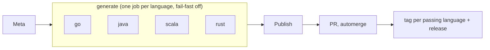

# protogen

Stubs generated from the [`protos`](https://github.com/huponx/protos) repo: every language and every service (`ping`, `courier`, ...) in one repo. Do not edit generated files by hand.

```
go/            # module github.com/huponx/protogen/go (go/vN/ for major >= 2)
  go.mod
  ping/v1/
java/          # Maven: pom.xml, stubs in src/main/java
scala/         # sbt: build.sbt, stubs in src/main/scala (package com.huponx.protogen.<proto package>)
rust/          # Cargo: Cargo.toml, stubs in src/gen
.github/
  workflows/   # generate.yml, check.yml, automerge.yml
  scripts/     # publish.sh
```

## Tags

One proto release `vX.Y.Z` produces:

| Tag | Meaning |
|---|---|
| `vX.Y.Z` | common tag and GitHub Release, created once at least one language succeeded; notes list pass/fail per language |
| `go/vX.Y.Z` | Go module `go/` (major 0, 1); `go/vN/vN.Y.Z` for the module in `go/vN/` (major N >= 2) |
| `java/vX.Y.Z`, `scala/vX.Y.Z`, `rust/vX.Y.Z` | one tag per language that succeeded |

A language that failed has no tag for that version.

## Use

Go (the tag `go/v0.2.0` makes `go get` work for a module in a subdirectory):

```bash
go get github.com/huponx/protogen/go@v0.2.0
```
```go
import pingv1 "github.com/huponx/protogen/go/ping/v1"
```

From major 2 the module is `github.com/huponx/protogen/go/v2`, so imports change to `.../go/v2/ping/v1`.

Rust (git dependency on the language tag; the crate lives in `rust/`):

```toml
protogen = { git = "https://github.com/huponx/protogen", tag = "rust/v0.2.0" }
```

Java / Scala: build from the tag (`mvn -Drevision=0.2.0 ...` / `PROTOGEN_VERSION=0.2.0 sbt ...`) or point JitPack at it. Publishing to a registry is not set up yet.

## CI

### [generate.yml](.github/workflows/generate.yml)

Triggered by `repository_dispatch` (`proto_release`, sent by the proto repo after a release) or **Run workflow** (`proto_ref`, optional `proto_repo`, optional `langs`).



1. `meta`: validates `proto_ref` (`vX.Y.Z`) and `proto_repo`, picks the languages.
2. `generate` (matrix): checks out the proto repo at `proto_ref`, runs `proto-src/scripts/generate.sh <lang>`, compiles the result (`go build`, `mvn compile`, `sbt compile`, `cargo check`) and uploads the stubs as an artifact. Each language is independent: a failure only affects that language.
3. `publish`: takes the languages that passed, commits their stubs on `generate/<ref>`, opens a PR with the `automerge` label, waits for it to merge (up to 45 minutes), tags each passing language on the merge commit, creates or updates the Release.

`main` is protected, so stubs are never pushed to it directly. The run fails when any language failed, but only after the passing ones were published.

The run summary has one row per language (`failure` first, marked `FAILED, no tag`) and each failure has an error annotation. `publish` uploads `result.json` (per-language status, PR, commit, release) as the `result` artifact; the proto repo's notify job reads it to report `failed_langs`.

To retry only failed languages, run the workflow with `proto_ref` and `langs` (for example `java rust`). If the common Release already exists it is updated. A language tag that exists with identical stubs is skipped; with different stubs it is reported as failed and never moved.

Only one generate run at a time (`concurrency: generate`, runs queue). `workflow_dispatch` must run on the default branch.

### Shared actions

`generate.yml` and `check.yml` use the composite actions `lang-setup` and `lang-compile` from [`huponx/actions`](https://github.com/huponx/actions) (`@main`; pin a tag once one exists). They take `lang` and `root` (the language directory).

### [check.yml](.github/workflows/check.yml)

Runs on every PR into `main`, including the bot PRs from `publish`: compiles each language from the committed stubs. The aggregate job `check` is the required status check.

### [automerge.yml](.github/workflows/automerge.yml)

Adds auto-merge to PRs labelled `automerge` (squash), using `BOT_TOKEN`.

## Setup

Tokens, secrets, labels, repository settings, branch and tag rulesets for both repos are documented step by step (with `gh` commands and ruleset JSON) in the proto repo: see **Setup (one time)** in [`protos/README.md`](https://github.com/huponx/protos#setup-one-time).

What this repo needs, in short:

| Name | Kind | Purpose |
|---|---|---|
| `BOT_TOKEN` | secret, required | open PRs that trigger `check`, enable auto-merge, push tags; a PAT or GitHub App with Contents RW, Pull requests RW, Metadata R, token owner is a repo admin. Events caused by `GITHUB_TOKEN` do not trigger workflows, so checks would never run on the stubs PR |
| `PROTO_REPO` | variable, optional | default proto repo for manual runs (default `huponx/protos`) |
| `PROTO_READ_TOKEN` | secret, optional | read access when the proto repo is private |
| `BUF_TOKEN` | secret, optional | avoids buf.build rate limits on remote plugins |

```bash
gh secret set BOT_TOKEN --repo huponx/protogen
gh label create automerge --repo huponx/protogen --color 0E8A16 --force
gh api -X PATCH repos/huponx/protogen -F allow_auto_merge=true -F delete_branch_on_merge=true -F allow_squash_merge=true
```

Then protect `main` (ruleset requiring a PR and the status check `check`, up to date) and the tags `v*`, `go/**`, `java/**`, `scala/**`, `rust/**` (ruleset JSON in the proto README, steps 5 and 6). Enable protection only after the workflows are on `main`.

`BUF_VERSION` in `generate.yml` must match the proto repo's `ci.yml`.

## Add a language

1. In `protos`: add `buf.gen.<lang>.yaml` and the language to `scripts/lib.sh`.
2. Here: add `<lang>/` with its build file (committed once; generation only replaces the stub directory), add a case in the shared `lang-setup` and `lang-compile` actions of [`huponx/actions`](https://github.com/huponx/actions), and add the name in `meta` of `generate.yml` and the matrix of `check.yml`.

## Local

```bash
# from the proto repo
PROTO_REF=v0.2.0 bash scripts/generate.sh go     # writes into ../protogen
```

Generation plugins and templates live in `protos`. `protogen` only stores stubs and publishes them.
